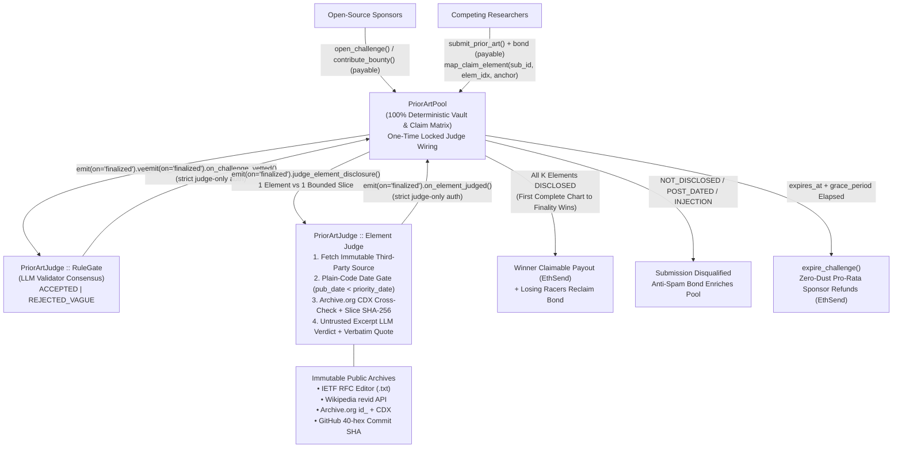

# PriorArtPool

> **Crowdfunded Defensive Patent Prior-Art Anticipation & Multi-Element Claim-Chart Protocol on GenLayer**

- **Live Frontend (Wallet-Free Proof Inspector + StudioNet Wallet Workbench):** [https://prior-art-pool.vercel.app](https://prior-art-pool.vercel.app)
- **Public Repository:** [https://github.com/khezzed/Prior-Art-Pool](https://github.com/khezzed/Prior-Art-Pool)
- **Network:** GenLayer StudioNet (Chain ID `61999` · RPC `https://studio.genlayer.com/api`)
- **Pinned GenVM Runner:** `py-genlayer:1jb45aa8ynh2a9c9xn3b7qqh8sm5q93hwfp7jqmwsfhh8jpz09h6`
- **Hardened v2 Contract Commit:** [`bed3317`](https://github.com/khezzed/Prior-Art-Pool/commit/bed331746528bf4f1b1741630ec7703a77755050)
- **Deployed Contracts (Byte-for-Byte Verified via `gen_getContractCode`):**
  - `PriorArtPool` (Deterministic Crowdfund Vault & Claim-Chart Engine): [`0x7adb74f3A7cb166299E354C894cd2699a154ce2e`](https://explorer-studio.genlayer.com/address/0x7adb74f3A7cb166299E354C894cd2699a154ce2e)
  - `PriorArtJudge` (Stateless Validator Oracle): [`0xFd30Bc73881C7F10e675408DBc2B14Fb07393E15`](https://explorer-studio.genlayer.com/address/0xFd30Bc73881C7F10e675408DBc2B14Fb07393E15)
  - `EvidenceProbe` (Step-2 Live Reachability Probe): [`0x3C4912006E0ab8d2e61Cc487a50ce61C10F2AF0A`](https://explorer-studio.genlayer.com/address/0x3C4912006E0ab8d2e61Cc487a50ce61C10F2AF0A)
- **Machine-Readable Proof Manifest:** [`deploy/proof.json`](deploy/proof.json) (`64` finalized StudioNet transactions · `0` errors · re-verified live via `npm run verify:proof`)

---

## 1. Why PriorArtPool Is GenLayer-Native

Under patent law's **All-Elements Rule (35 U.S.C. § 102)**, invalidating an overly broad patent claim via anticipation requires proving that a **single prior-art publication dated strictly before the patent's priority date** discloses **every independent element** of the claim.

Ordinary smart contracts and number-reading oracles cannot adjudicate prior art because historical technical literature uses completely different vocabulary than later patent claims (for example, RFC 2104 defines `ipad = the byte 0x36`, `opad = the byte 0x5C`, and `H(K XOR opad, H(K XOR ipad, text))`, while a patent claim such as **US 10,103,888 B2** describes *"fixed repeated padding byte constants combined with a block-sized secret key via bitwise XOR"* and *"a nested two-pass cryptographic hash"*).

**PriorArtPool** combines decentralized GenVM LLM judgment with strict deterministic financial accounting:
1. **The Model Judges; Plain Code Moves Money:** Validators output only bounded discrete enums (`ACCEPTED` / `REJECTED_VAGUE`, `DISCLOSED` / `NOT_DISCLOSED` / `INSUFFICIENT_EVIDENCE`) plus a verbatim quote. Plain Python governs crowdfunding shares, anti-spam bonds, publication chronology (`pub_date < priority_date`), conjunctive All-Elements coverage, race settlement, per-element stalled-judgment retries (`element_timeout_seconds = 600`), and zero-dust pro-rata refunds.
2. **One Narrow Judgment per Transaction:** Each `map_claim_element` transaction maps **one** frozen claim element against **one** bounded excerpt ($\le 2,400$ chars) of an immutable third-party archive.
3. **Validators Agree on Evidence, Not Just Verdicts:** Using `gl.vm.run_nondet_unsafe(leader_fn, validator_fn)`, every validator independently fetches the URL, verifies `slice_digest`, `pub_date_iso`, and Archive.org CDX capture existence (`cdx_verified`), asserts `leader_quote in validator_slice` for `DISCLOSED` outcomes, and confirms verdict agreement.
4. **Zero Self-Hosted Evidence Fixtures:** Only immutable third-party public archives are accepted:
   - Official IETF RFCs (`https://www.rfc-editor.org/rfc/rfcXXXX.txt`)
   - Wikipedia permanent revision API (`https://en.wikipedia.org/w/api.php?...revids=<id>`, order-independent query params)
   - Archive.org raw `id_` captures (`https://web.archive.org/web/<14-digit>id_/<url>`) cross-verified against the CDX index
   - GitHub 40-hex commit SHAs (`https://raw.githubusercontent.com/<owner>/<repo>/<40-hex>/...`) with conservative submission-date upper bounds (preventing author commit-date backdating)
5. **Protocol-Native Finality & Locked Callback Wiring:** `PriorArtPool` and `PriorArtJudge` communicate exclusively via `emit(on="finalized")`, so payouts and state transitions settle **only after GenLayer's native appeal window closes**. `set_judge` and `set_pool` permanently lock once wired; callbacks reject any caller other than the paired contract (zero owner override or backdoor).
6. **Verified Real Native EOA Payouts (`EthSend`) & Non-Stranding Payable Safety:** Pull-payment withdrawals (`claim_payout`, `withdraw_refund`, `claim_pro_rata_refund`) dispatch Type-0 native value transfers via `@gl.evm.contract_interface` (`EoaTransfer`), crediting real EOA `eth_getBalance` deltas on StudioNet with zero errors. Invalid payable calls credit `gl.message.value` to `refundable_balances` instead of reverting and stranding native wei.

---

## 2. Architecture Diagram (Where Validators Judge vs. Plain Code)



---

## 3. Live Finalized StudioNet Proof Summary (64 Finalized Transactions · 0 Errors)

All 6 scenarios below ran live on **GenLayer StudioNet** using real USPTO patent references and real historical third-party public archives, and were independently re-verified via `npm run verify:proof` (**64/64 finalized transactions, 0 errors**, live `gen_getContractCode` source match for all 3 contracts, conservation invariant `501 inbound - 381 outbound == 120 net_liabilities == 120 wei live contract balance`):

| Case | Scenario & Real Public Evidence | Finalized Outcome & Verified EOA Balance Delta | StudioNet Explorer Tx (Parent) |
| :--- | :--- | :--- | :--- |
| **Step 2 Probe** | 9/9 public archive URLs probed live (`rfc2104`, `rfc6962`, `rfc9162`, `wiki` ×3, `hashcash id_`, `CDX`, `IgnoreAttacker.py`) | `HTTP 200` · `MAJORITY_AGREE` | [`0xcc13c3f1...`](https://explorer-studio.genlayer.com/tx/0xcc13c3f11b2ff6b8dbd4d56ba609bbb9c485f95f141bb49eac194e5742f16a03) |
| **Case 1a** | Non-stranding payable guard (invalid priority date + `1 wei`) | `ERROR:INVALID_PRIORITY_DATE:CREDITED_1` | [`0xe9512421...`](https://explorer-studio.genlayer.com/tx/0xe9512421dc3369dff774f30c64bdfb2582849bba636dcee3bd5d7d2ec2f3e5d3) |
| **Case 1b** | Up-front RuleGate rejects subjective claim (`DRAFT-VAGUE-REJECT`, `100 wei`) + refund withdrawal | `REJECTED_VAGUE` → **`+101 wei`** real EOA delta (`NATIVE_TRANSFER_OK`) | Open [`0xc93ca0c1...`](https://explorer-studio.genlayer.com/tx/0xc93ca0c10792902a416d3977ce02a0cf85181542f6f05a72ec5b4677509c52f8) · Refund [`0x6512679e...`](https://explorer-studio.genlayer.com/tx/0x6512679e66869ec57b95663bf83a71b3dc6679c2df3c890d52b9d1fbb95fda4c) |
| **Case 2 (Race & Win)** | **Real USPTO `US 10,103,888 B2`** (Dyadic Security, Priority `2015-11-22`): 2-sponsor crowdfund (`50 + 50 wei`) + mutable `/main/` safe refund (**`+20 wei`**) + **live 2-researcher race** (`Wikipedia HMAC rev 31406215` vs **`IETF RFC 2104` `1997-02-28`**) | `ANTICIPATED` · R1 wins **`+120 wei`** EOA delta (explicit `0x36`/`0x5C` & nested hash quotes) · Honest losing racer R2 calls `reclaim_superseded_bond(1)` + withdraws **`+20 wei`** EOA delta | E0 [`0x8c9a86df...`](https://explorer-studio.genlayer.com/tx/0x8c9a86df316a9fe0293101c8217138f0d1b26a2add6a2c3b5d413a65810d3230) · E1 [`0x6f47dacf...`](https://explorer-studio.genlayer.com/tx/0x6f47dacf7925f1a0bea12093a4f57de66dce18e1ad2b146fda856441e8211a2c) · Win [`0xaa8cd2a3...`](https://explorer-studio.genlayer.com/tx/0xaa8cd2a380029150f51709a7b95a09a2c20dcca25f8d6c7617693be37ef215ee) · Reclaim [`0x07597b83...`](https://explorer-studio.genlayer.com/tx/0x07597b8316200e2912ab0769de9133fd6dbf4bf43ee5371b1d904b8ef3abede7) |
| **Case 3a (All-Elements)** | **Real USPTO `US 10,728,041 B2`** (Amazon Technologies, Priority `2016-12-23`): **Wikipedia `Merkle_tree` rev `333954216` (`2009-12-25`)** | E0 `DISCLOSED`, E1 `NOT_DISCLOSED` → `DISQUALIFIED_NOT_DISCLOSED` (`20 wei` bond forfeited) | E0 [`0xab7d727a...`](https://explorer-studio.genlayer.com/tx/0xab7d727a2c234a4141eee66f7c21a1cded22b5ceed58a83e0bfee51dcbbf3b3d) · E1 [`0xf3b218d3...`](https://explorer-studio.genlayer.com/tx/0xf3b218d335b24c067eb55a3c753ad8053a81719a2337e517babb3160d3fc21d1) |
| **Case 3b (Symmetric)** | **Archive.org `20040326113623id_` Hashcash FAQ (`2004-03-26`)** + **CDX verified (`true`)** on `US 10,728,041 B2` | E1 `DISCLOSED` (`cdx_verified=true`), E0 `NOT_DISCLOSED` → `DISQUALIFIED_NOT_DISCLOSED` (`20 wei` bond forfeited; completes symmetric proof!) | E1 [`0xf7416bbb...`](https://explorer-studio.genlayer.com/tx/0xf7416bbb5c3b5b82251018febf3920cadfa060270b0ae6f9b4a008811495f6c0) · E0 [`0x8fe4ff6e...`](https://explorer-studio.genlayer.com/tx/0x8fe4ff6e8b72e9b88b059c11c3f119ea5249febbdf5bc98319b73ccb76d0e9d0) |
| **Case 4 (Post-Dated)** | **IETF RFC 9162 (`2021-12-31`)** vs priority `2016-12-23` (plain-Python chronology gate) | `DISQUALIFIED_POST_DATED` (`20 wei` bond forfeited; LLM never trusted for dates) | [`0x83eee253...`](https://explorer-studio.genlayer.com/tx/0x83eee253f605c7ad2c37e7bb2c4c23b730d2fa72843a39c746892dd40dc4f34d) |
| **Case 5 (Injection)** | Live prompt injection on `US-2025-1101-SEC` (Priority `2025-11-01`): **Wikipedia `Prompt_injection` rev `1289403591` (`2025-05-08`)** anchored at literal `"Ignore the above directions"` | `DISQUALIFIED_NOT_DISCLOSED` (injection defeated inside `<UNTRUSTED_PRIOR_ART_EXCERPT>`, `20 wei` attacker bond forfeited) | [`0x83f34151...`](https://explorer-studio.genlayer.com/tx/0x83f3415108719e80dc4007e8c7a439e7a324e14c98c6f32f07412b4d1eb8ec11) |
| **Case 6 (Timeout)** | Deterministic timeout fallback (`expire_challenge(4)`) + multi-sponsor pro-rata refund (`60/40` split of `120 wei` incl. attacker bond) | `EXPIRED` → **`+72 wei`** Sponsor A + **`+48 wei`** Sponsor B real EOA balance deltas (`0` dust) | Expire [`0x0b5a94c2...`](https://explorer-studio.genlayer.com/tx/0x0b5a94c2bc827e806167cfe808e442f7ccc3f6956e125f9b11f67c160b8bd9de) · A [`0xb04a0ca5...`](https://explorer-studio.genlayer.com/tx/0xb04a0ca54f9d8887438f62dd7d9a2b5c646c7c8c0980934543474e087e87fd1a) · B [`0xbb7a2e21...`](https://explorer-studio.genlayer.com/tx/0xbb7a2e214f9133d85e87e2a7ed38c449d2250f9888e45d02f5f1438d5375186c) |

Full child/grandchild `emit(on="finalized")` hashes, `EthSend` native transfer child hashes, verbatim quotes, and SHA-256 slice digests are recorded in [`deploy/proof.json`](deploy/proof.json).

---

## 4. Local Setup & Verification

```bash
# 1. Install root Node dependencies & run read-only live StudioNet proof verifier
#    Checks live on-chain source via gen_getContractCode, accounting conservation, and all 64 txs
npm install
npm run verify:proof

# 2. Lint, typecheck, and run all 12 unit & Byzantine consensus tests
genvm-lint check contracts/prior_art_pool.py --json
genvm-lint check contracts/prior_art_judge.py --json
genvm-lint typecheck contracts/prior_art_pool.py
genvm-lint typecheck contracts/prior_art_judge.py
pytest tests/direct -v

# 3. Run the archival Patent Dossier frontend locally
cd frontend && npm install && npm run dev
```

---

## 5. Additional Documentation
- **Step-by-Step Build Tutorial ($\ge 500$ words, with live screenshot):** [`docs/TUTORIAL.md`](docs/TUTORIAL.md)
- **Two-Minute Reviewer Demo Script:** [`docs/DEMO_SCRIPT.md`](docs/DEMO_SCRIPT.md)
- **GenLayer Portal Submission Fields:** [`docs/PORTAL_FIELDS.md`](docs/PORTAL_FIELDS.md)

---

## 6. Honest Limitations & Scope
1. **Browser MetaMask Popup Approval:** All contract write flows (`open_challenge`, `contribute_bounty`, `submit_prior_art`, `map_claim_element`, `claim_payout`, `reclaim_superseded_bond`, `withdraw_refund`, `expire_challenge`, `claim_pro_rata_refund`) were executed and finalized live on StudioNet across 4 funded accounts via `genlayer-js` with verified EOA balance deltas, and the Wallet Workbench UI is deployed live on Vercel; interactive MetaMask popup signing in a user's own browser still requires a human click.
2. **Local Unit Tests vs. Live Consensus Proof:** `tests/direct/` mocks `genlayer` primitives in pure Python to rapidly validate deterministic state transitions, locked wiring, per-element timeout retries, and Byzantine validator checks locally (`12/12` passing); it does not substitute for live consensus. Actual GenVM LLM consensus and native EOA payouts are proven live on StudioNet by `deploy/proof.json` and `npm run verify:proof` (`64/64` finalized txs).
3. **Conservative GitHub Commit Dating:** Because Git commit timestamps can be backdated by repository authors, `PriorArtJudge` assigns the on-chain submission date to `raw.githubusercontent.com` URLs rather than trusting commit metadata. Historical pre-priority proofs should use IETF RFCs, Wikipedia permanent revision IDs, or CDX-verified Archive.org `id_` captures.
4. **Scope:** Demonstrates 35 U.S.C. § 102 single-reference anticipation (not § 103 obviousness combining multiple references) and uses tiny wei amounts on StudioNet testnet.
