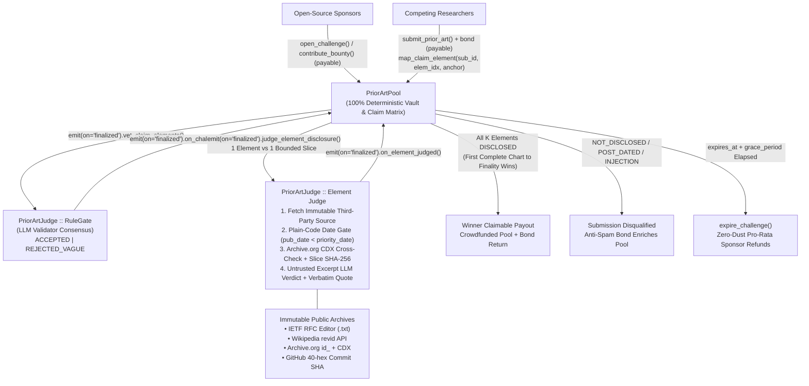

# PriorArtPool

> **Crowdfunded Defensive Patent Prior-Art Anticipation & Multi-Element Claim-Chart Protocol on GenLayer**

- **Live Frontend (Wallet-Free Proof Inspector + StudioNet Wallet Flows):** [https://prior-art-pool.vercel.app](https://prior-art-pool.vercel.app)
- **Public Repository:** [https://github.com/khezzed/Prior-Art-Pool](https://github.com/khezzed/Prior-Art-Pool)
- **Network:** GenLayer StudioNet (Chain ID `61999` · RPC `https://studio.genlayer.com/api`)
- **Pinned GenVM Runner:** `py-genlayer:1jb45aa8ynh2a9c9xn3b7qqh8sm5q93hwfp7jqmwsfhh8jpz09h6`
- **Contract Source Commit:** [`89375cc`](https://github.com/khezzed/Prior-Art-Pool/commit/89375ccf04f5c01b5a5b9392ec62a3c2171acc3b)
- **Deployed Contracts:**
  - `PriorArtPool` (Deterministic Crowdfund Vault & Claim-Chart Engine): [`0x8d448f8e7Acca6459bE3cf4B80ccc17BcA4957FE`](https://explorer-studio.genlayer.com/address/0x8d448f8e7Acca6459bE3cf4B80ccc17BcA4957FE)
  - `PriorArtJudge` (Stateless Validator Oracle): [`0x2Ed9A19063E082b6c829b370e0D3374be37f40C3`](https://explorer-studio.genlayer.com/address/0x2Ed9A19063E082b6c829b370e0D3374be37f40C3)
  - `EvidenceProbe` (Step-2 Live Reachability Probe): [`0x3C4912006E0ab8d2e61Cc487a50ce61C10F2AF0A`](https://explorer-studio.genlayer.com/address/0x3C4912006E0ab8d2e61Cc487a50ce61C10F2AF0A)
- **Machine-Readable Proof Manifest:** [`deploy/proof.json`](deploy/proof.json) (`57` finalized StudioNet transactions verified via `npm run verify:proof`)

---

## 1. Why PriorArtPool Is GenLayer-Native

Under patent law's **All-Elements Rule (35 U.S.C. § 102)**, invalidating an overly broad patent claim via anticipation requires proving that a **single prior-art publication dated strictly before the patent's priority date** discloses **every independent element** of the claim.

Ordinary smart contracts and number-reading oracles cannot adjudicate prior art because historical technical literature uses completely different vocabulary than later patent claims (for example, RFC 2104 defines `ipad`, `opad`, and `H(K XOR opad, H(K XOR ipad, text))`, while a patent claim describes *"combining a shared secret key with two fixed padding byte strings via bitwise XOR"* and *"a nested two-pass cryptographic hash"*).

**PriorArtPool** combines decentralized GenVM LLM judgment with strict deterministic financial accounting:
1. **The Model Judges; Plain Code Moves Money:** Validators output only bounded discrete enums (`ACCEPTED` / `REJECTED_VAGUE`, `DISCLOSED` / `NOT_DISCLOSED` / `INSUFFICIENT_EVIDENCE`) plus a verbatim quote. Plain Python governs crowdfunding shares, anti-spam bonds, publication chronology (`pub_date < priority_date`), conjunctive All-Elements coverage, race settlement, and zero-dust pro-rata refunds.
2. **One Narrow Judgment per Transaction:** Each `map_claim_element` transaction maps **one** frozen claim element against **one** bounded excerpt ($\le 2,400$ chars) of an immutable third-party archive.
3. **Validators Agree on Evidence, Not Just Verdicts:** Using `gl.vm.run_nondet_unsafe(leader_fn, validator_fn)`, every validator independently fetches the URL, verifies `slice_digest`, `pub_date_iso`, and Archive.org CDX capture existence (`cdx_verified`), asserts `leader_quote in validator_slice` for `DISCLOSED` outcomes, and confirms verdict agreement.
4. **Zero Self-Hosted Evidence Fixtures:** Only immutable third-party public archives are accepted:
   - Official IETF RFCs (`https://www.rfc-editor.org/rfc/rfcXXXX.txt`)
   - Wikipedia permanent revision API (`https://en.wikipedia.org/w/api.php?action=query&prop=revisions&rvprop=timestamp|content&format=json&revids=<id>`)
   - Archive.org raw `id_` captures (`https://web.archive.org/web/<14-digit>id_/<url>`) cross-verified against the CDX index
   - GitHub 40-hex commit SHAs (`https://raw.githubusercontent.com/<owner>/<repo>/<40-hex>/...`) with conservative submission-date upper bounds (preventing author commit-date backdating)
5. **Protocol-Native Finality Callbacks:** `PriorArtPool` and `PriorArtJudge` communicate exclusively via `emit(on="finalized")`, so payouts and state transitions settle **only after GenLayer's native appeal window closes**.
6. **Non-Stranding Payable Safety:** Invalid payable calls (`open_challenge`, `contribute_bounty`, `submit_prior_art`) credit `gl.message.value` to `refundable_balances` instead of reverting and stranding native wei on StudioNet.

---

## 2. Architecture Diagram (Where Validators Judge vs. Plain Code)



---

## 3. Live Finalized StudioNet Proof Summary (57 Finalized Transactions)

All 6 scenarios below ran live on **GenLayer StudioNet** using real historical third-party public archives and were independently re-verified via `npm run verify:proof` (**57/57 finalized transactions**, conservation invariant `481 inbound - 361 outbound == 120 net_liabilities == 120 wei live contract balance`):

| Case | Scenario & Real Public Evidence | Finalized Outcome | StudioNet Explorer Tx (Parent) |
| :--- | :--- | :--- | :--- |
| **Step 2 Probe** | 6/6 public URLs (`rfc2104`, `rfc6962`, `wiki rev 333954216`, `hashcash id_`, `CDX`, `IgnoreAttacker.py`) | `HTTP 200` · `MAJORITY_AGREE` | [`0xcc13c3f1...`](https://explorer-studio.genlayer.com/tx/0xcc13c3f11b2ff6b8dbd4d56ba609bbb9c485f95f141bb49eac194e5742f16a03) |
| **Case 1a** | Non-stranding payable guard (invalid priority date + `1 wei`) | `ERROR:INVALID_PRIORITY_DATE:CREDITED_1` | [`0xe887703b...`](https://explorer-studio.genlayer.com/tx/0xe887703bc251dc4a169a00bbb0d2673d3e95b3bc0fe91e91d7a97ca036a02f27) |
| **Case 1b** | Up-front RuleGate rejects subjective claim (`100 wei`) + `101 wei` withdrawal | `REJECTED_VAGUE` → `REFUND_WITHDRAWN:101` | [`0x431bbe27...`](https://explorer-studio.genlayer.com/tx/0x431bbe273b88382da233154515c36fcafe75f3d3954280769098101204b6b4ac) · [`0xae9840ef...`](https://explorer-studio.genlayer.com/tx/0xae9840ef19c0d8e383106e947d123f3c93cc1ec73ab0cee88faf0d21800a1257) |
| **Case 2** | 2-sponsor crowdfund (`50 + 50 wei`) + **IETF RFC 2104 (`1997-02-28 < 2002-01-01`)** maps E0 & E1 + mutable `/main/` rejection | `ANTICIPATED` · Researcher 1 wins `120 wei` | E0 [`0x796b01fa...`](https://explorer-studio.genlayer.com/tx/0x796b01fa0109baa513c67b5daeaa6116ecec53f6744ac5b7dbfa13627d5f26fd) · E1 [`0x32054eff...`](https://explorer-studio.genlayer.com/tx/0x32054effb3a366b510e0fea04d927ab6c212d0ba5b5db064b9f1eca2922d2834) · Win [`0x8b5d89e9...`](https://explorer-studio.genlayer.com/tx/0x8b5d89e9d21f6358f1a3d59e1db7accb98e5599804ff93fac31c612cbd385b1d) |
| **Case 3a** | **Wikipedia `Merkle_tree` rev `333954216` (`2009-12-25`)**: E0 `DISCLOSED`, E1 `NOT_DISCLOSED` | `DISQUALIFIED_NOT_DISCLOSED` (`20 wei` bond forfeited) | E0 [`0xa752972d...`](https://explorer-studio.genlayer.com/tx/0xa752972dc87e58e5ad2328bde05673bb9c0390fe9299ed3db7bb8a64dfa6709e) · E1 [`0xff6478b6...`](https://explorer-studio.genlayer.com/tx/0xff6478b6388d068f939003b648cd2377ec5ce999907da11c7b02a49551e943ac) |
| **Case 3b** | **Archive.org `20040326113623id_` Hashcash FAQ** + **CDX verified (`true`)** | `E1 DISCLOSED` (`2004-03-26`, verbatim quote verified) | [`0x9e126309...`](https://explorer-studio.genlayer.com/tx/0x9e12630977dc47e582deb0b6322f5b7c7184449961aa700b114a003478b840f9) |
| **Case 4** | **IETF RFC 6962 (`2013-06-30`)** vs priority `2011-01-01` (plain-code chronology gate) | `DISQUALIFIED_POST_DATED` (`20 wei` bond forfeited) | [`0xe35075df...`](https://explorer-studio.genlayer.com/tx/0xe35075dfc19596a363d3ad2f942219e0d51fdf050bdd43ae3ae2043681a54b31) |
| **Case 5** | Live prompt injection: `liu00222/Open-Prompt-Injection/IgnoreAttacker.py` (`"Ignore previous instructions."`) | `DISQUALIFIED_NOT_DISCLOSED` (injection defeated, `20 wei` bond forfeited) | [`0x556ac4ad...`](https://explorer-studio.genlayer.com/tx/0x556ac4adcf44d7556e1e24c0fba58ccdbe4219e78b0b7ff8328d6eba3eaeeaca) |
| **Case 6** | Timeout fallback (`expire_challenge(4)`) + multi-sponsor pro-rata refund (`60/40` split of `120 wei` incl. attacker bond) | `EXPIRED` → `72 wei` Sponsor A + `48 wei` Sponsor B (`0` dust) | Expire [`0x94798e32...`](https://explorer-studio.genlayer.com/tx/0x94798e32b44944b450e3dc904cbc1021f9a32b8fb653a46eb0dfb4fd40d89c9a) · A [`0xdfee1aea...`](https://explorer-studio.genlayer.com/tx/0xdfee1aeaf83c42ee3e35492eba0de158820a4baa6658d8023c6bcfbcc900fb9f) · B [`0xee8aafe4...`](https://explorer-studio.genlayer.com/tx/0xee8aafe408907d21dca054a62cefb194324484d1bc6277b8749b1ad9d6bb4016) |

Full child/grandchild `emit(on="finalized")` hashes, verbatim quotes, and SHA-256 slice digests are recorded in [`deploy/proof.json`](deploy/proof.json).

---

## 4. Local Setup & Verification

```bash
# 1. Install root Node dependencies & run read-only live StudioNet proof verifier
npm install
npm run verify:proof

# 2. Lint, typecheck, and run all 11 direct-mode unit & Byzantine consensus tests
genvm-lint check contracts/prior_art_pool.py --json
genvm-lint check contracts/prior_art_judge.py --json
genvm-lint typecheck contracts/prior_art_pool.py
genvm-lint typecheck contracts/prior_art_judge.py
pytest tests/direct -v

# 3. Run the frontend locally
cd frontend && npm install && npm run dev
```

---

## 5. Additional Documentation
- **Step-by-Step Build Tutorial ($\ge 500$ words):** [`docs/TUTORIAL.md`](docs/TUTORIAL.md)
- **Two-Minute Reviewer Demo Script:** [`docs/DEMO_SCRIPT.md`](docs/DEMO_SCRIPT.md)
- **GenLayer Portal Submission Fields:** [`docs/PORTAL_FIELDS.md`](docs/PORTAL_FIELDS.md)

---

## 6. Honest Limitations & Scope
1. **StudioNet `emit_transfer` to EOAs:** Pull-payment withdrawals (`withdraw_refund`, `claim_payout`, `claim_pro_rata_refund`) invoke the official GenVM SDK method `gl.get_contract_at(Address(sender)).emit_transfer(value=u256(amount), on="finalized")`. On StudioNet, the parent transaction finalizes `SUCCESS` and cleanly debits `PriorArtPool`'s native contract balance (verified live: `481 - 361 == 120 wei`), while StudioNet's simulator routes the emitted child value transfer (`calldata: "Bg=="`) through `contract_not_found_handler` when the recipient is an EOA without deployed contract code. Both the parent and child tx hashes are transparently surfaced in `deploy/proof.json` and `verify:proof`.
2. **Browser Wallet Popups:** All contract write flows (`open_challenge`, `contribute_bounty`, `submit_prior_art`, `map_claim_element`, `claim_payout`, `withdraw_refund`, `expire_challenge`, `claim_pro_rata_refund`) were executed and finalized live on StudioNet using 4 funded accounts via `genlayer-js`, and the Wallet Flows UI is live on Vercel; interactive MetaMask popup approval in the user's own browser still requires a human click.
3. **Conservative GitHub Commit Dating:** Because Git commit timestamps can be backdated by repository authors, `PriorArtJudge` assigns the on-chain submission date to `raw.githubusercontent.com` URLs rather than trusting commit metadata. Historical pre-priority proofs should use IETF RFCs, Wikipedia permanent revision IDs, or CDX-verified Archive.org `id_` captures.
4. **Scope:** Demonstrates § 102 single-reference anticipation (not § 103 obviousness combining multiple references) and uses tiny wei amounts on StudioNet testnet.
