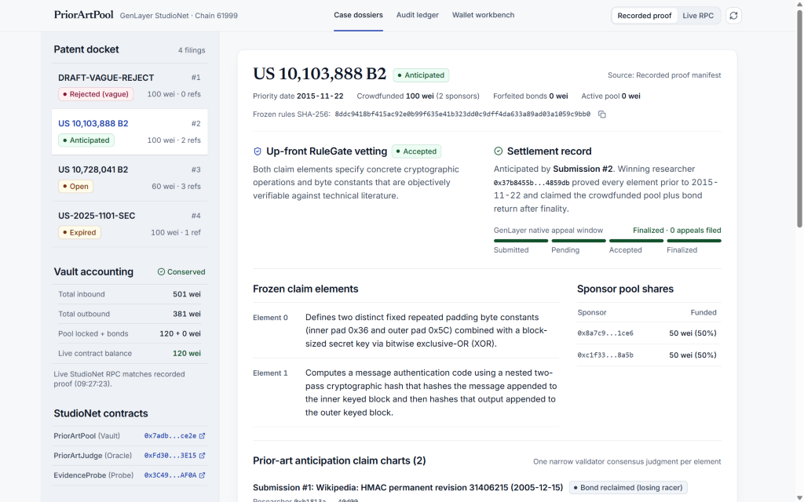

# Building a Multi-Contract Prior-Art Anticipation Protocol on GenLayer

*A step-by-step engineering tutorial built directly from the deployed `PriorArtPool` and `PriorArtJudge` Intelligent Contracts.*

---

## Why Traditional Oracles Cannot Adjudicate Patent Prior Art

Under patent law's **All-Elements Rule (35 U.S.C. § 102)**, a patent claim is anticipated (invalidated) if and only if a **single** prior-art publication dated **strictly before the patent's priority date** discloses **every** independent limitation of the claim.

Traditional smart contracts and data oracles fail at this task for two fundamental reasons:
1. **Vocabulary mismatch:** Historical technical literature almost never shares phrasing with a later patent claim. For example, IETF RFC 2104 (February 1997) defines `ipad = 0x36`, `opad = 0x5C`, and `H(K XOR opad, H(K XOR ipad, text))`, whereas a patent claim may describe *"combining a shared secret key with two distinct fixed repeated padding byte strings via bitwise XOR"* and *"a nested two-pass cryptographic hash."* Regex and keyword oracles fail completely here.
2. **Evidence stability & trust:** Pulling a live web page without immutability guarantees lets validators fetch different bytes and fail consensus—or lets a malicious participant edit a page after submission.

GenLayer's **GenVM** solves this by letting decentralized validators run LLMs over live web fetches and reach consensus on narrow interpretations. However, getting reliable consensus on a live network requires strict architectural discipline. Below is the exact pattern implemented in **PriorArtPool**.

---

## Step 1: Probe Live Evidence Reachability First

Before writing any business logic, deploy a minimal probe contract (`contracts/evidence_probe.py`) to GenLayer StudioNet (Chain ID `61999`) to verify that validators—not just your local machine—can fetch every target archive with strict byte-level consensus:

```python
# { "Depends": "py-genlayer:1jb45aa8ynh2a9c9xn3b7qqh8sm5q93hwfp7jqmwsfhh8jpz09h6" }
from genlayer import *
import hashlib, json

class EvidenceProbe(gl.Contract):
    results: TreeMap[str, str]
    probe_count: u256

    @gl.public.write
    def probe_get(self, label: str, target_url: str) -> str:
        def fetch_and_digest() -> str:
            resp = gl.nondet.web.get(target_url)
            status = int(getattr(resp, "status", 0))
            body = getattr(resp, "body", b"")
            text = body.decode("utf-8", errors="replace") if isinstance(body, bytes) else str(body)
            sample = text.replace("\r\n", "\n")[:2000]
            digest = hashlib.sha256(sample.encode("utf-8")).hexdigest()
            return json.dumps({"label": label, "status": status, "sample_digest": digest}, sort_keys=True)

        res = gl.eq_principle.strict_eq(fetch_and_digest)
        self.results[label] = res
        self.probe_count = u256(int(self.probe_count) + 1)
        return res
```

Running `npm run probe:studionet` confirmed `HTTP 200` and `MAJORITY_AGREE` across four distinct immutable public archives:
- **IETF RFC Editor:** `https://www.rfc-editor.org/rfc/rfc2104.txt`, `rfc6962.txt`, and `rfc9162.txt`
- **Wikipedia Permanent Revision API:** `https://en.wikipedia.org/w/api.php?action=query&prop=revisions&rvprop=timestamp|content&format=json&revids=333954216`
- **Archive.org raw `id_` capture + CDX index:** `https://web.archive.org/web/20040326113623id_/http://www.hashcash.org/faq/`
- **Pinned 40-hex GitHub commits:** `https://raw.githubusercontent.com/<owner>/<repo>/<40-hex>/...`

---

## Step 2: Separate Money from Nondeterminism with `emit(on="finalized")`

A foundational rule in GenLayer engineering is: **the model judges; plain code moves money.** We split the protocol into two contracts:

1. **`PriorArtPool` (`contracts/prior_art_pool.py`)** — 100% deterministic. It custodies multi-sponsor crowdfunded bounties, tracks researcher anti-spam bonds, checks the conjunctive All-Elements Matrix, enforces deadlines/pro-rata refunds, and maintains the conservation invariant:
   $$\text{total\_pool\_locked} + \text{total\_bonds\_held} + \text{total\_claimable} + \text{total\_refundable} = \text{total\_inbound} - \text{total\_outbound}$$
2. **`PriorArtJudge` (`contracts/prior_art_judge.py`)** — Stateless nondeterministic validator oracle running two narrow prompts:
   - `vet_claim_elements`: up-front RuleGate rejecting vague or subjective claim elements before a pool opens.
   - `judge_element_disclosure`: evaluates **one** frozen claim element against **one** bounded excerpt per transaction.

Crucially, `PriorArtPool` dispatches jobs and moves payouts strictly via **GenLayer finality callbacks**:

```python
gl.get_contract_at(Address(self.judge_address)).emit(on="finalized").judge_element_disclosure(
    submission_id,
    int(sub["challenge_id"]),
    element_index,
    challenge["priority_date_iso"],
    sub["submitted_date_iso"],
    challenge["elements"][element_index],
    sub["reference_url"],
    clean_anchor,
)
```

And for pull-payment payouts to externally owned accounts (EOAs), avoid `gl.get_contract_at(eoa).emit_transfer(...)`—which dispatches a Type-2 GenVM contract call and fails with `contract_not_found_handler` when the recipient is not a contract. Instead, declare a minimal `@gl.evm.contract_interface` so `emit_transfer` routes through `EthSend` and credits the EOA's native StudioNet balance directly:

```python
@gl.evm.contract_interface
class EoaTransfer:
    class View:
        pass
    class Write:
        pass

EoaTransfer(Address(sender)).emit_transfer(value=u256(amount))
```

In addition, lock cross-contract wiring permanently once initialized (`if self.judge_address: raise gl.vm.UserError("JUDGE_ALREADY_LOCKED")`) and restrict callbacks strictly to `self.judge_address` (never `self.owner`) so no deployer can forge validator outcomes.

Because `on="finalized"` fires only after GenLayer's native appeal window closes, an appealed or overturned leader proposal can never trigger a premature payout.

---

## Live Dossier Interface



---

## Step 3: Guard Payable Inputs So Funds Never Strand

On StudioNet, a failed `@gl.public.write.payable` call that raises an exception can still credit incoming `gl.message.value` to the contract while rolling back state changes. Every payable entrypoint in `PriorArtPool` (`open_challenge`, `contribute_bounty`, `submit_prior_art`) accounts for `total_inbound` first and credits invalid calls to `refundable_balances[sender]` instead of reverting:

```python
sender = str(gl.message.sender_address).lower()
value = int(gl.message.value)
self.total_inbound = u256(int(self.total_inbound) + value)

if not _is_valid_immutable_url(reference_url):
    self._credit_refundable(sender, value)
    return f"ERROR:MUTABLE_OR_UNSUPPORTED_URL:CREDITED_{value}"
```

Any user who accidentally submits a mutable `/main/` GitHub URL or invalid priority date immediately recovers 100% of their wei via `withdraw_refund()`.

---

## Step 4: Deterministic Chronology, Bounded Slicing, and Evidence-Grounded Consensus

Never ask an LLM to judge dates or parse a 50KB HTML page raw. In `PriorArtJudge._fetch_and_prepare_evidence()`:

1. **URL Allowlist:** Rejects mutable branches, non-`id_` Archive.org URLs (which inject varying toolbars), and self-hosted endpoints.
2. **Authoritative Date Parsing:**
   - For **IETF RFCs**, parses `Month YYYY` from the official header using conservative end-of-month days (`February 1997` → `1997-02-28`).
   - For **Wikipedia**, parses the server-assigned `timestamp` field directly from MediaWiki API JSON (`2009-12-25`).
   - For **Archive.org `id_`**, queries the **CDX API** (`filter=timestamp:<ts14>`) to prove capture existence before accepting the date (`2004-03-26`).
   - For **GitHub raw commits**, refuses author-backdatable git timestamps and conservatively assigns the on-chain submission date.
3. **Plain-Code Date Gate:** If `pub_date_iso >= priority_date_iso`, execution immediately short-circuits to `POST_DATED` with zero LLM invocation.
4. **Bounded Slicing & Hashing:** Extracts at most `2,400` characters centered on `anchor_text` and hashes the slice with SHA-256 (`slice_digest`).
5. **Untrusted Data Isolation & Quote Verification:** Wraps the excerpt in `<UNTRUSTED_PRIOR_ART_EXCERPT>` tags with anti-injection directives. Inside `gl.vm.run_nondet_unsafe(leader_fn, validator_fn)`, every independent validator re-fetches the URL, checks exact `slice_digest`, `pub_date_iso`, and `cdx_verified` equality, confirms `leader_quote in validator_slice` for `DISCLOSED` verdicts, and verifies verdict agreement.

---

## Step 5: Deterministic Fallbacks, Per-Element Retries & Pro-Rata Refunds

Every waiting state has an exit:
- If RuleGate vetting stalls past `vetting_deadline`, `reclaim_stalled_vetting()` refunds the sponsor.
- If a single `map_claim_element` judgment stalls past `element_timeout_seconds`, `map_claim_element()` deterministically permits retry without waiting for challenge expiry.
- If a challenge passes `expires_at + grace_period_seconds` without a complete finalized anticipation chart, anyone can call `expire_challenge()`. Plain code marks stuck `PENDING` elements as `INSUFFICIENT_EVIDENCE`, distributes the pool (plus any forfeited spam/attacker bonds) pro-rata to every crowdfunder with zero rounding dust, and unlocks `claim_pro_rata_refund()`.

---

## Step 6: Local Tests, Live Finality, and On-Chain Source Verification

Run the fast local checks before touching StudioNet:

```bash
# 1. Static lint & GenVM typecheck
genvm-lint check contracts/prior_art_pool.py --json
genvm-lint check contracts/prior_art_judge.py --json
genvm-lint typecheck contracts/prior_art_pool.py
genvm-lint typecheck contracts/prior_art_judge.py

# 2. Local unit & Byzantine consensus tests (12 tests)
pytest tests/direct -v

# 3. Verify live on-chain source (gen_getContractCode == local repo), balances, and finalized txs
npm run verify:proof
```

By combining narrow single-element semantic consensus with deterministic chronology, finality callbacks, and non-stranding multi-sponsor accounting, `PriorArtPool` turns GenLayer validators into an autonomous defensive patent prior-art engine.
